# Requisitos e Fluxo de Telas — TCC Wagner Duarte
 
**Contexto:** Comparação entre GitHub Spec Kit e BMAD-METHOD, aplicadas à construção de um app Flutter com arquitetura BLoC/Clean Architecture. O app (diário reflexivo com IA) é o veículo neutro do experimento — sua "essência" de produto se mantém, mas os requisitos abaixo estão organizados pela lente de **o que gera dado comparativo entre as duas metodologias**, não pela completude do produto em si.
 
---
 
## 1. Requisitos Funcionais — Núcleo Comparativo
 
Construídos e medidos em **ambos** os ciclos (Spec Kit e BMAD-METHOD).
 
### RF01 — Captura Multimodal (texto/áudio/foto)
**Estressa:** camada de serviços / integração de device.
Entrada de dados via texto, gravação de áudio em tempo real e upload de fotografia — sempre pela Tela 2 (Modal de Inserção), que passa a ter também um campo de texto bruto, não só microfone e galeria. Toda captura aqui vira um registro persistido (`POST /entries`), **distinto de uma mensagem de chat** (ver nota de separação em RF04).
**Critérios de aceite:**
- As três modalidades (texto, áudio, foto) resultam no mesmo formato de entrada persistida — nenhuma é tratada de forma estruturalmente diferente das outras após a captura.
- Cancelar a captura no meio (ex: interromper gravação) não cria uma entrada parcial/vazia.
### RF02 — Processamento STT/OCR
**Estressa:** camada de serviços / integração de API externa.
Transcrição de áudio (speech-to-text) e reconhecimento de texto em imagem (OCR) sobre o conteúdo capturado no RF01.
**Critérios de aceite:** quatro estados visíveis — gravando, processando, transcrito, erro de transcrição.
 
### RF03 — Cofre de Autenticação Biométrica
**Estressa:** camada de serviços / segurança.
Barreira de acesso via Face ID / Touch ID / PIN antes de expor dados do usuário.
**Critérios de aceite:**
- Falha de biometria (ex: dedo não reconhecido) oferece PIN como alternativa, sem travar o usuário fora do app.
- App em background e retomado após 5 minutos exige nova autenticação — não fica indefinidamente desbloqueado (valor fixo, não configurável pelo usuário, para manter os dois ciclos comparáveis).
### RF04 — Chat Interativo com Memória (RAG)
**Estressa:** BLoC (estado assíncrono complexo) + camada de dados.
Conversa contínua com o agente de IA, com busca semântica sobre entradas anteriores. **Mensagens de chat são conversacionais e não criam entradas de diário automaticamente** — a única exceção é a ação explícita de salvar descrita no RF10. Fora isso, o chat consulta as entradas existentes via RAG, mas não escreve nelas.
**Critérios de aceite:**
- Três estados obrigatórios de UI: processando/streaming, erro, resposta completa.
- Se o streaming da resposta cair no meio, a mensagem parcial permanece visível com indicação de falha (não desaparece).
### RF05 — Exportação de Resumo Pessoal
*(Renomeado — anteriormente "Relatórios Clínicos"; removida a conotação médica/diagnóstica, fora do escopo do projeto.)*
**Estressa:** camada de serviços / permissões de sistema.
Geração de um resumo narrativo por IA (Claude Haiku 4.5) a partir das entradas do usuário, exportável em PDF, com opção adicional de baixar os dados brutos sem narrativa. **Escopo medido: geração do job, download do arquivo e tratamento de falha — nunca a qualidade do texto narrativo gerado.**
**Critérios de aceite:**
- Job de exportação com zero entradas no período retorna um estado de erro tratado (não um PDF vazio nem crash).
- Falha na geração do texto narrativo (timeout do modelo) ainda permite baixar os dados brutos sem narrativa — a exportação não fica bloqueada por uma falha de IA.
### RF06 — Busca Semântica/Filtro sobre Entradas do Diário
**Estressa:** BLoC + camada de dados / offline.
Busca por similaridade semântica (via embeddings Voyage AI, reaproveitando os já gerados no RF01) combinada com filtros de metadado (data, tipo de entrada). *(Correção em 10/09/2026 — a versão anterior deste requisito também citava "categoria" como dimensão de filtro; o backend real não implementa filtro por tag/categoria em nenhum endpoint — `GET /entries`/`GET /entries/search` só aceitam `source` e `dateFrom`/`dateTo`. Consistente com a Seção 2: a categorização é "tags manuais" e não recebe implementação funcional em nenhum dos dois ciclos — tags só aparecem embutidas, para leitura, no objeto `Entry`.)*
**Critérios de aceite:**
- Busca por um termo encontra entradas relacionadas semanticamente mesmo sem a palavra exata (ex: buscar "ansiedade" retorna uma entrada que só menciona "nervosismo", sem o termo literal).
- Debounce de busca de 300ms: digitação rápida dispara uma única consulta, não uma por tecla.
- Resultado do cache local de leitura permanece consistente com o servidor após reconexão, sem duplicar itens exibidos *(ajustado — arquitetura é cloud-only; offline permite apenas visualização de dados já cacheados, não escrita)*.
- Dois ou mais filtros aplicados simultaneamente (`source`+`dateFrom`/`dateTo`) restringem com lógica E (não OU).
- Limpar filtros retorna à lista completa sem reiniciar a tela.
### RF07 — Histórico Multi-fonte (Timeline)
**Estressa:** composição de múltiplos BLoCs.
Tela cujo estado depende simultaneamente de autenticação, status de sincronização e dados das entradas.
**Critérios de aceite:**
- Expiração de sessão durante visualização dispara prompt de novo login sem crash e sem perder a posição de scroll.
- Badge de status de sincronização por entrada atualiza independentemente da stream de autenticação.
- Nenhum BLoC importa outro BLoC diretamente (checável via revisão de imports ou extensão do lint de arquitetura do RNF06).
### RF08 — Insights Proativos (mecanismo)
**Estressa:** isolamento de falha / concorrência.
Sugestão inserida no chat sem o usuário pedir. **Escopo medido: apenas o mecanismo de disparo, nunca a qualidade do texto gerado.**
**Critérios de aceite:**
- Gatilho após N=5 mensagens do usuário OU T=2min de inatividade — dispara exatamente uma vez por condição satisfeita.
- Se a geração do insight falhar (timeout/erro de rede), o chat principal continua funcionando normalmente.
- Descartar o insight não altera scroll nem estado da conversa principal.
### RF09 — Resumos Temporais / Dashboard
**Estressa:** agregação de dados + visualização.
Gráfico de evolução com balanço textual, computado sob demanda ao abrir a aba de Configurações. **Escopo medido: agregação e renderização, nunca a qualidade do texto narrativo.**
**Critérios de aceite:**
- Renderiza corretamente em três cenários: zero entradas, uma entrada, >30 entradas.
- Agregação recalcula corretamente após criar uma entrada (teste de invalidação de cache). *(Correção em 10/09/2026 — a versão anterior também citava "editar/apagar uma entrada"; entradas são imutáveis por decisão de arquitetura, D3 — "conteúdo original íntegro, nunca censurado". Não existe `PATCH /entries/:id` nem `DELETE /entries/:id` no backend real, e nenhuma tela deste documento descreve uma ação de editar/apagar entrada — o texto anterior não correspondia a nenhuma interação de fato prevista.)*
- Texto narrativo da IA só é checado quanto a não quebrar a UI em casos extremos — nunca quanto ao conteúdo.
### RF10 — Salvar Mensagem do Chat como Entrada
**Estressa:** comunicação entre features dentro da Clean Architecture (o chat precisa acionar a criação de uma entrada sem depender diretamente da camada de dados do RF01).
Botão em cada mensagem do usuário no chat que a converte numa entrada persistida — para os momentos em que o usuário insere um dado relevante durante a conversa, não só via captura dedicada (RF01). Reaproveita o mesmo pipeline de `POST /entries` (checagem de PII + embedding), com a origem marcada como `chat`.
**Critérios de aceite:**
- A feature de chat aciona a criação da entrada através de uma interface/caso de uso compartilhado, nunca importando diretamente um repositório ou datasource da feature de entradas — violação aqui conta para o RNF06.
- Salvar a mesma mensagem duas vezes não cria entradas duplicadas (idempotência).
- Falha ao salvar (rede indisponível) mantém a conversa funcionando normalmente e o botão retorna a um estado que permite tentar de novo — mesmo padrão de isolamento de falha do RF08.
- Só mensagens do usuário têm o botão — respostas da IA não podem virar entrada.
---
 
## 2. Requisitos Funcionais — Extensão de Produto
 
Mantêm a "essência" do fluxo original e existem no protótipo do Claude Design, mas **não recebem implementação funcional em nenhum dos dois ciclos comparativos** — ficam como trabalho futuro na monografia.
 
| Requisito original | Tratamento na versão atual |
|---|---|
| Categorização Dinâmica (IA) | Simplificada para tags manuais criadas pelo usuário (tela Meus Registros) |
| Extração Autônoma de Metas | Tela Planos de Ação — estática, sem lógica |
| Ajuste Dinâmico de Persona | Toggle cosmético simples (Configurações), baixo custo de manter |
 
---
 
## 3. Requisitos Não Funcionais — Núcleo Mensurável (automatizáveis)
 
| ID | Requisito | Ferramenta / mecânica | Meta |
|---|---|---|---|
| RNF06 | Zero Violações de Camada | Lint de arquitetura (`clean_architecture_kit` ou `import_linter`) — domínio não pode importar `package:flutter` nem classes de `data/` | 0 violações |
| RNF07 | Cobertura Mínima de Testes | `flutter test --coverage` + `very_good_coverage`, filtrado para `lib/**/domain/**` | ≥80% |
| RNF08 | Fidelidade Visual ao Protótipo | Rubrica de 3 pontos por tela (cor primária bate o hex do protótipo / tipografia bate família+tamanho / espaçamento dentro de ±4dp) + check estático de valores hardcoded fora do arquivo central `design_tokens.dart` | Score 0–3 por tela + 0 hardcodes |
| RNF09 | Tratamento de Erro de Rede Consistente | Padrão `Either<Failure, T>` via `fpdart`; check estático de assinaturas de repositório + testes com `mocktail` simulando falhas em todos os endpoints de escrita (5 endpoints × 3 tipos de falha — timeout, resposta malformada, sem conexão) | 0 assinaturas fora do padrão / 15 de 15 cenários tratados |
 
## 4. Requisitos Não Funcionais — Higiene (não comparativos)
 
RNF01 — Latência de Interação (ação local reflete na UI em <100ms; qualquer chamada de rede acima de 300ms exibe indicador de carregamento) · RNF02 — PII Stripping (via Claude Haiku 4.5 com prompt estruturado/tool use, não um modelo de NER dedicado) · RNF03 — Zero Data Retention · RNF04 — RLS (Row Level Security) · RNF05 — Hard Delete de Conta/Dados (LGPD)
 
**Limitação consciente:** o sistema não possui protocolo de detecção/resposta a sinais de risco (ideação suicida, autolesão) em entradas ou mensagens de chat. Como o produto não é mais enquadrado como app de saúde mental, essa ausência é uma decisão de escopo explícita — vale registrá-la como limitação reconhecida na monografia, não como lacuna esquecida.
 
---
 
## 5. Arquitetura de Interface e Fluxo de Telas
 
### 5.1 Fundação Visual (Design System)
Identidade minimalista, paleta acolhedora e neutra, tipografia sans-serif legível, componentes padronizados (botões, balões de chat, cartões). Esta fundação é o objeto direto do RNF08.
 
### 5.2 Telas
 
**Tela 0 — Splash Screen:** carregamento inicial; verifica conexão e sincroniza cache em background. *Conecta a: RF06, RNF01.*
 
**Tela 0.1 — Cofre de Autenticação:** barreira biométrica/PIN antes do acesso. *Conecta a: RF03.*
 
**Tela 1 — Home (Chat):** tela principal, conversa contínua, botão "+" para entrada multimodal, indicador de estado da IA, botão "salvar no diário" em cada mensagem do usuário. *Conecta a: RF04, RF08, RF10, RNF01, RNF09.*
 
**Tela 2 — Modal de Inserção:** overlay com três formas de captura — campo de texto bruto, microfone (áudio) e galeria/câmera (foto) — com indicador de transcrição. Toda captura aqui cria uma entrada persistida, nunca uma mensagem de chat. *Conecta a: RF01, RF02.*
 
**Tela 3 — Menu Lateral (Sidebar):** hub de navegação, histórico de sessões, acesso a Meus Registros/Planos de Ação/Configurações. Deverá ganhar um botão "Novo Chat" (pendência aberta em 10/09/2026, ver Seção 13.1) que leva à Tela 1 em estado vazio. *Conecta a: RF04 (via botão "Novo Chat"); demais itens são navegação pura.*
 
**Tela 4 — Meus Registros:** timeline consolidada, filtros, tags manuais, exportação. *Conecta a: RF07, RF06, RF05; extensão de categorização.*
 
**Tela 5 — Planos de Ação:** painel Kanban simples (colunas "A Fazer" / "Em Andamento" / "Concluído") com cards estáticos de exemplo. *(Extensão — existe visualmente no protótipo do Claude Design para completude da demo, mas sem lógica funcional em nenhum dos dois ciclos comparativos.)*
 
**Tela 6 — Configurações e Perfil:** dashboard de evolução, seletor de persona — "Analítico" / "Empático" / "Socrático" (extensão, só troca a string do system prompt do RF04), apagar conta. *Conecta a: RF09, RNF05; extensão de persona.*
 
---
 
## 6. Inventário de Endpoints do Backend

*(Seção corrigida em 10/09/2026 para bater com os 23 endpoints do backend
real e congelado — `contracts/openapi.yaml` é a fonte de verdade de
contrato; esta seção é só uma leitura orientada por tela/requisito dela.
A versão anterior desta seção continha 3 endpoints descartados por
decisões de arquitetura (`biometric-unlock` — D2, `PATCH /entries/:id` —
D3, os 3 endpoints de tag — T-015) e não citava o endpoint de retry do
chat, que existe de verdade — ver nota de reconciliação em
`context/Contexto Geral.md`.)*
 
Backend único, compartilhado pelos dois ciclos (Spec Kit e BMAD-METHOD), construído com RIPER antes de qualquer um dos ciclos começar. Todos os endpoints seguem o contrato de erro padronizado do RNF09 — `{ code, message, retryable }` — e passam por RLS no Supabase. Provedores de IA: Claude (chat, visão/OCR, resumo, insights, dashboard, detecção de PII) e Voyage AI (embeddings) — únicas duas dependências externas de IA do backend. Transcrição de áudio (STT) roda on-device (Whisper), nunca chega ao backend como arquivo de áudio.
 
### 6.1 Autenticação e sessão
| Endpoint | Requisito | IA envolvida |
|---|---|---|
| `POST /auth/signup` | RF03 | — |
| `POST /auth/login` | RF03 | — |
| `POST /auth/refresh` | RF03, RF07 | — |
| `GET /auth/session` | RF07 | — |
| `POST /auth/logout` | RF03 | — |

**Sem endpoint de "biometric-unlock" — intencional (D2):** a barreira Face ID/Touch ID/PIN da Tela 0.1 é validada 100% no aparelho, nunca no servidor. O backend só guarda a preferência (`profiles.biometricEnabled`, lida/escrita via `PATCH /account/settings`, Seção 6.7) — não valida biometria nenhuma. Depois de passar pela barreira local, o app usa a sessão já existente (renovada via `POST /auth/refresh` se preciso, ou `POST /auth/login` se tiver expirado de vez).
 
### 6.2 Ingestão e entradas
| Endpoint | Requisito | IA envolvida |
|---|---|---|
| `POST /media/ocr` — imagem não é persistida, só o texto extraído segue adiante | RF02 | Claude Haiku 4.5 (visão) |
| `POST /entries` — cria entrada; dispara checagem de PII e geração de embedding internamente; aceita `source` (`manual`/`audio`/`photo`/`chat`) e `chatMessageId` quando a origem é o chat | RF01, RF02, RF10 | Claude Haiku 4.5 (PII) + Voyage AI (embedding) |
| `GET /entries` — filtra por `source`/`dateFrom`/`dateTo`; tags só aparecem embutidas na resposta, para leitura | RF07 | — |
| `GET /entries/:id` | RF07 | — |

**Sem edição/exclusão de entrada, nem endpoint de tag — intencional (D3/T-015):** entradas são imutáveis depois de criadas (D3 — "conteúdo original íntegro, nunca censurado"); não existe `PATCH`/`DELETE /entries/:id`. Tags (`tags`/`entry_tags`) são populadas só pelo seed de teste — nenhum endpoint cria, apaga ou filtra por tag/categoria (ver correção do RF06, Seção 1). Isso é consistente com a Seção 2 deste documento: a "Categorização Dinâmica" foi simplificada para tags manuais que **não recebem implementação funcional em nenhum dos dois ciclos comparativos**.
 
### 6.3 Chat e memória (RAG)
| Endpoint | Requisito | IA envolvida |
|---|---|---|
| `POST /chat/sessions` — bloqueado offline | RF04 | — |
| `GET /chat/sessions` — funciona offline (cache) | RF04, RF07 | — |
| `GET /chat/sessions/:id/messages` — funciona offline (cache) | RF04 | — |
| `POST /chat/sessions/:id/messages` — streaming (SSE); bloqueado offline | RF04 | Voyage AI (embedding da pergunta) + Claude Sonnet 5 (resposta) |
| `POST /chat/sessions/:id/messages/:userMessageId/retry` — regenera a resposta sem duplicar a pergunta do usuário; é o que sustenta "mensagem parcial visível com indicação de falha, e um jeito de tentar de novo" do RF04 | RF04 | Voyage AI (embedding, reaproveitado do cache) + Claude Sonnet 5 (resposta) |
| `POST /chat/sessions/:id/insight` | RF08 | Claude Haiku 4.5 |
| `POST /entries` — chamado a partir do botão "salvar no diário" (ver 6.2) | RF10 | Claude Haiku 4.5 (PII) + Voyage AI (embedding) |
 
### 6.4 Busca
| Endpoint | Requisito | IA envolvida |
|---|---|---|
| `GET /entries/search?q=&source=&dateFrom=&dateTo=&limit=` — sem `category` (ver correção do RF06, Seção 1) | RF06 | Voyage AI (embedding da query) |
 
### 6.5 Exportação
| Endpoint | Requisito | IA envolvida |
|---|---|---|
| `POST /export/summary` — job assíncrono | RF05 | Claude Haiku 4.5 |
| `GET /export/:jobId/status` | RF05 | — |
| `GET /export/:jobId/download` | RF05 | — |
 
### 6.6 Dashboard
| Endpoint | Requisito | IA envolvida |
|---|---|---|
| `GET /dashboard/aggregate?period=` — separado do texto para não bloquear o gráfico | RF09 | — |
| `GET /dashboard/narrative?period=` | RF09 | Claude Haiku 4.5 |
 
### 6.7 Conta
| Endpoint | Requisito | IA envolvida |
|---|---|---|
| `PATCH /account/settings` — inclui toggle de persona (extensão) | RNF05, extensão | — |
| `DELETE /account` | RNF05 | — |
 
---
 
## 7. Fluxograma Integrado — Telas × Requisitos × Backend

*(Diagrama corrigido em 10/09/2026 — mesma reconciliação da Seção 6: `E03`
deixou de ser uma chamada de endpoint (não existe `biometric-unlock`),
`E13`/`E14` (edição de entrada / tag) foram removidos por não existirem,
e o endpoint de retry do chat (`E06b`) e o de status da exportação
(`E15b`) — que existem de verdade mas não apareciam aqui — foram
adicionados.)*

```mermaid
flowchart TD
    subgraph T0["Tela 0 — Splash"]
        direction TB
        E01["GET /auth/session"]
    end
 
    subgraph T01["Tela 0.1 — Cofre de autenticação · RF03"]
        direction TB
        E02b["Face ID / Touch ID / PIN — validado no aparelho, sem chamada ao backend (D2)"]
        E02["POST /auth/login (se a sessão já tiver expirado de vez)"]
    end
 
    subgraph T1["Tela 1 — Home (chat) · RF04, RF08, RF10"]
        direction TB
        E04["POST /chat/sessions"]
        E05["GET /chat/sessions/:id/messages"]
        E06["POST /chat/sessions/:id/messages"]
        E06b["POST .../messages/:userMessageId/retry"]
        E07["POST /chat/sessions/:id/insight"]
        E07b["POST /entries (salvar mensagem)"]
    end
 
    subgraph T2["Tela 2 — Modal de inserção · RF01, RF02"]
        direction TB
        E08["POST /media/ocr"]
        E09["POST /entries"]
    end
 
    subgraph T3["Tela 3 — Menu lateral"]
        direction TB
        E10["GET /chat/sessions"]
        E10b["Botão 'Novo Chat' — adicionado 11/09/2026, ver §13.1; leva a T1 vazia, sustentado por E04"]
    end
 
    subgraph T4["Tela 4 — Meus registros · RF05, RF06, RF07"]
        direction TB
        E11["GET /entries (source/dateFrom/dateTo — sem categoria)"]
        E12["GET /entries/search"]
        E15["POST /export/summary"]
        E15b["GET /export/:jobId/status"]
        E16["GET /export/:jobId/download"]
    end
 
    subgraph T5["Tela 5 — Planos de ação (extensão)"]
        direction TB
        E17["Sem chamadas — estática"]
    end
 
    subgraph T6["Tela 6 — Configurações · RF09, RNF05"]
        direction TB
        E18["GET /dashboard/aggregate"]
        E19["GET /dashboard/narrative"]
        E20["PATCH /account/settings"]
        E21["DELETE /account"]
        E22["POST /auth/logout"]
    end
 
    T0 --> T01 --> T1
    T1 --> T2
    T1 --> T3
    T3 -->|Novo Chat| T1
    T3 --> T4
    T3 --> T5
    T3 --> T6
 
    style T5 fill:#FAEEDA,stroke:#BA7517,color:#412402
```
 

 
*(Subgraph "Planos de ação" em âmbar marca a única tela sem chamadas de backend — extensão de produto, fora do núcleo comparativo.)*
 
---
 
## 8. Métricas de Comparação entre Ciclos (Spec Kit vs. BMAD-METHOD)
 
O que efetivamente transforma os dois ciclos numa comparação, e não só duas construções isoladas.
 
### 8.1 Métricas de processo (coletadas manualmente durante o ciclo)
| Métrica | Como medir |
|---|---|
| Tempo de setup inicial | Horas customizando a `constitution.md` (Spec Kit) ou configurando agentes/templates (BMAD) antes da primeira linha de código |
| Tempo total do ciclo | Horas do início ao fim, por RF individual e total |
| Custo de tokens do ciclo de desenvolvimento | Consumo de tokens do Claude Code durante a construção (não confundir com tokens do backend em produção) |
| Nº de artefatos gerados | Documentos de especificação produzidos (spec.md/plan.md/tasks.md vs. PRD/architecture.md/stories) |
| Taxa de correção / intervenções manuais | Nº de vezes que o desenvolvedor precisou interromper e redirecionar o agente, anotado durante a construção de cada RF |
| Aderência ao plano | Comparação entre o plano gerado (plan.md/tasks.md no Spec Kit; architecture.md/stories no BMAD) e o código final entregue — quantas divergências não documentadas |
 
### 8.2 Métricas de produto (automatizadas, coletadas ao final do ciclo)
| Métrica | Origem |
|---|---|
| Violações de camada | RNF06 |
| Cobertura de testes no domínio | RNF07 |
| Score de fidelidade visual | RNF08 |
| Cenários de erro de rede tratados corretamente | RNF09 |
| Taxa de conformidade com critérios de aceite, por RF (RF01–RF10) | Soma dos critérios de aceite definidos em cada RF na Seção 1 — quantos passam vs. total definido, por ciclo |
| Complexidade ciclomática (camada de domínio) | Média por método + contagem de métodos acima do limiar (>10), via DCM (pago) ou fork open-source do `dart_code_metrics` (gratuito) |
| Taxa de regressão | % de testes que passavam num RF anterior e passam a falhar após um RF novo — roda a suíte completa do RNF07 a cada RF implementado, não só no final do ciclo |
 
### 8.3 Métricas diferenciais (desenhadas para maximizar divergência entre as metodologias)
Miram especificamente a diferença estrutural entre um pipeline de agente único (Spec Kit) e um fluxo multiagente com reset de contexto entre fases (BMAD) — são as com maior chance de mostrar divergência grande, não marginal, entre os dois ciclos.
 
| Métrica | Como medir |
|---|---|
| Fidelidade de handoff entre agentes | Escolher 8–10 decisões técnicas específicas registradas no `plan.md`/`architecture.md` (ex: padrão `Either<Failure,T>`, isolamento entre BLoCs) e verificar quantas aparecem corretamente implementadas no código final — mede perda de contexto na transição entre fases/agentes |
| Consistência de padrões entre features | Escolher 3–4 convenções concretas (nome de classe de erro, nomenclatura de métodos de repositório, estrutura de pastas) e comparar se RF01 e RF09/RF10 — implementados em momentos distantes do ciclo — seguem o mesmo padrão ou divergem |
 
### 8.4 Ameaça à validade ainda em aberto
A ordem dos ciclos (qual metodologia roda primeiro) não está resolvida — efeito de aprendizado continua sendo uma ameaça real, independente da metodologia. Precisa virar uma seção explícita de "Ameaças à Validade" na monografia, documentando a limitação em vez de escondê-la.
 
---
 
## 9. Modelo de Dados (Schema)
 
Entidades principais que o backend precisa implementar no Supabase (Postgres). Nomes de campo são sugestão de referência, não obrigatórios char a char.
 
| Tabela | Campos principais | Notas |
|---|---|---|
| `users` | id, email, biometric_enabled, persona, created_at | RLS: usuário só acessa a própria linha |
| `entries` | id, user_id, content, source (`manual`/`audio`/`photo`/`chat`), chat_message_id (nullable), embedding (vector, ver 10), sync_status, created_at, updated_at | `embedding` gerado no `POST /entries` via Voyage AI |
| `tags` | id, user_id, name | Extensão — criadas manualmente pelo usuário |
| `entry_tags` | entry_id, tag_id | Tabela de junção N:N |
| `chat_sessions` | id, user_id, title, created_at | — |
| `chat_messages` | id, session_id, role (`user`/`assistant`), content, created_at | Mensagens do usuário exibem o botão do RF10 |
| `export_jobs` | id, user_id, status (`pending`/`processing`/`done`/`error`), period_start, period_end, file_url, created_at | Assíncrono — ver 6.5 |
 
**Padrão de RLS (todas as tabelas com `user_id`):** política `auth.uid() = user_id`, sem exceção.
 
---
 
## 10. Stack Tecnológico (Resumo Consolidado)
 
| Camada | Escolha | Onde foi decidido |
|---|---|---|
| App mobile | Flutter, BLoC, Clean Architecture | Tópico 1 |
| Metodologias comparadas | GitHub Spec Kit vs. BMAD-METHOD | Tópico 1 |
| Backend (build) | RIPER, fora da comparação | Tópico 4 |
| Infraestrutura | Supabase (Postgres + pgvector + Storage + Auth + RLS) | Tópico 4 |
| Chat / visão / OCR / resumo / insights / dashboard / PII | Claude Sonnet 5 (chat) + Claude Haiku 4.5 (o resto) | Tópico 4 |
| Embeddings (RAG) | Voyage AI (`voyage-3` ou `voyage-4`) | Tópico 4 |
| STT (transcrição de áudio) | Whisper on-device (`whisper_ggml`), nunca chega ao backend | Tópico 4 |
| Tratamento de erro | `fpdart` (`Either<Failure, T>`) | RNF09 |
| Lint de arquitetura | `clean_architecture_kit` ou `import_linter` | RNF06 |
| Cobertura de testes | `flutter test --coverage` + `very_good_coverage` | RNF07 |
| Complexidade ciclomática | DCM (pago) ou fork open-source do `dart_code_metrics` | Métrica 11 (Seção 8.2) |
 
---
 
## 11. Parâmetros de Configuração (fixados para reprodutibilidade entre ciclos)
 
Valores travados propositalmente — nenhum dos dois ciclos deve reinterpretar esses números, senão a comparação deixa de ser justa.
 
| Parâmetro | Valor | Requisito |
|---|---|---|
| Timeout de sessão em background | 5 min | RF03 |
| Debounce de busca | 300ms | RF06 |
| Gatilho de insight proativo | 5 mensagens OU 2 min de inatividade | RF08 |
| Cenários de renderização do dashboard | 0 / 1 / >30 entradas | RF09 |
| Cobertura mínima de testes (domínio) | ≥80% | RNF07 |
| Limiar de complexidade ciclomática | >10 por método | Seção 8.2 |
| Latência de UI local | <100ms | RNF01 |
| Limiar de indicador de carregamento | >300ms | RNF01 |
| Cenários de erro de rede testados | 5 endpoints × 3 falhas = 15 | RNF09 |
| Decisões de plano checadas (fidelidade de handoff) | 8–10 | Seção 8.3 |
 
---
 
## 12. Taxonomia de Códigos de Erro (RNF09)
 
Todo endpoint retorna `{ code, message, retryable }`. Códigos mínimos a implementar nos dois ciclos, para manter o contrato idêntico:
 
| Código | Situação | `retryable` |
|---|---|---|
| `AUTH_EXPIRED` | Sessão expirada, precisa reautenticar | não |
| `AUTH_INVALID` | Credenciais/biometria inválidas | não |
| `NETWORK_TIMEOUT` | Requisição excedeu o tempo limite | sim |
| `NETWORK_OFFLINE` | Sem conexão — ação bloqueada (ver RF04/RF06) | sim |
| `VALIDATION_ERROR` | Corpo da requisição malformado | não |
| `PII_CHECK_FAILED` | Checagem de PII falhou antes de persistir | sim |
| `EMBEDDING_FAILED` | Voyage AI indisponível/erro | sim |
| `AI_GENERATION_TIMEOUT` | Claude não respondeu a tempo (chat/insight/resumo/dashboard) | sim |
| `NOT_FOUND` | Recurso não existe ou não pertence ao usuário | não |
| `RATE_LIMITED` | Limite de requisições excedido | sim |
 
---
 
## 13. Congelamento do Protótipo (Fase 7, checklist final de congelamento)

O arquivo `ux/Cerne - Prototipo Final.html` é a referência visual congelada
do produto — nenhuma tela/estado descrito neste documento pode divergir
dele a partir de 10/09/2026. Hash calculado para detectar qualquer edição
posterior, acidental ou não:

| Campo | Valor |
|---|---|
| Arquivo | `ux/Cerne - Prototipo Final.html` |
| SHA-256 | `61032a92f082044f979cc52f65ae2d6cb461f0420f2bd9bc676f6115185d2fff` |
| Tamanho | 3.603.870 bytes |
| Data do congelamento | 2026-09-11T03:04:01Z |

**Como reconferir:** `sha256sum "ux/Cerne - Prototipo Final.html"` deve
reproduzir o mesmo valor acima. Se não bater, o protótipo foi alterado
depois do congelamento — parar e reportar antes de prosseguir com
qualquer um dos dois ciclos comparativos (armadilha do apêndice do
`big-plan.md`: nenhuma referência congelada muda depois do congelamento).

### 13.1 Resolvida em 11/09/2026 — botão "Novo Chat"

Nova versão do protótipo recebida (commit `4aec9e8`), com o botão
**"Novo Chat"** acrescentado à Tela 3 — Menu Lateral, conforme decidido
em `Contexto Geral.md` Seção 2.1. Confirmado por comparação direta contra
a versão anterior (commit `38cd6eb`): o texto "Novo Chat" não existia
nela e aparece 1 vez na nova. SHA-256/tamanho/data acima já refletem esta
versão — este é o hash congelado vigente a partir de agora.

- **Nenhum endpoint mudou** — `POST /chat/sessions` já suporta múltiplas
  sessões por usuário sem restrição, como previsto.
- O item "Protótipo congelado" do checklist final (`big-plan.md`) está
  novamente fechado com este hash.

---

*Documento de referência — Tópicos 2, 3 e 4 da revisão de escopo do TCC. Consolidado a partir da discussão registrada na memória do projeto.*
 